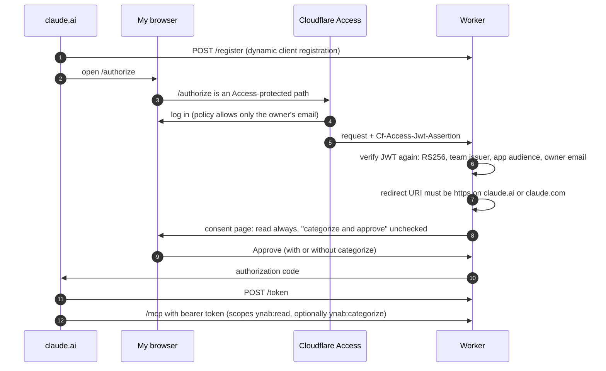
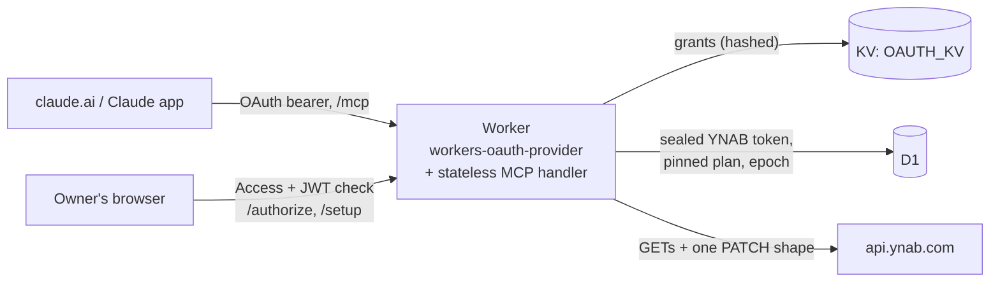

# ynab-mcp

> **Retired and archived (2026-11-27).** I moved to YNAB's official MCP server. This repo stays up as a record of how it was built and run, and it is no longer maintained.

A remote [MCP](https://modelcontextprotocol.io) server on Cloudflare Workers that lets Claude read my YNAB budget and, when I allow it, categorize and approve transactions while I watch. Only I can authorize it: Cloudflare Access proves who I am, an OAuth consent page sets what Claude may do, and the Worker's code limits the one write YNAB can receive.

## Architecture

### Sign-in: Cloudflare Access, then consent

claude.ai adds the Worker as a custom connector at `/mcp`. Before Claude gets a token, I sign in through Cloudflare Access and choose what to grant on the consent page.



- **Access covers only `/authorize` and `/setup*`.** Claude's servers call `/register`, `/token` and `/mcp` without a browser, and YNAB calls `/oauth/callback`, so the whole hostname can't sit behind Access.
- **The Worker checks the Access JWT again on every protected request** ([`mcp/access.mjs`](mcp/access.mjs)). A loosened or misconfigured Access policy still can't let anyone else authorize.
- **Writing is opt-in at consent time.** A grant without `ynab:categorize` can't call the write tool, and with claude.ai's "Needs approval" setting in a Manual-mode chat, every write waits for my confirm click (Auto mode may skip that prompt).

### Connecting YNAB

YNAB is a separate sign-in on `/setup`, also behind Access, with CSRF checks on every form. The Worker runs YNAB's OAuth flow, seals the token with AES-GCM under a `VAULT_KEY` secret, stores it in D1, and pins one budget ("plan").



### Tools

| Tool | Scope | What it does |
| --- | --- | --- |
| `get_connection` | read | Whether YNAB is connected, and the pinned plan |
| `get_month_summary` | read | Month totals and categories |
| `get_budget_report` | read | Per-category assigned, spent, available and status |
| `list_categories` | read | Category ids for Claude to choose from |
| `list_transactions_to_review` | read | Uncategorized or unapproved transactions |
| `categorize_transactions` | categorize | Set the category and approve, up to 10 at a time |

### The three biggest design calls

1. **Two separate sign-ins, with Access as the identity gate.** Claude signs in to the Worker, and the Worker signs in to YNAB, independently. I rejected chaining them (one flow that stores the YNAB token in Claude's grant). That would have thrown away the token vault and refresh logic, and every new Claude grant would re-grant YNAB. With the sign-ins separate, I can reconnect Claude without touching YNAB, and disconnect YNAB without touching Claude.
2. **The write is contained in code, because YNAB can't contain it.** YNAB OAuth offers only read-only or full access, and categorizing needs full access. So one function builds every outbound write. It allows only `PATCH /plans/{pinned}/transactions`, with a body of `id`, `category_id` and `approved: true`, and every other request is a GET. Before writing, the Worker re-reads each transaction and skips it as `changed` if its category, approval, amount, date or account no longer match what Claude showed me. It refuses splits, transfers, and hidden, deleted, credit-card-payment or internal categories (except "Inflow: Ready to Assign", so income can be categorized), failing closed on anything it doesn't recognize. It marks a transaction `uncertain` if YNAB's response doesn't match the request.
3. **A stateless handler over an epoch-guarded vault.** Each MCP request reads the owner's current epoch from D1 and carries it through every read. A disconnect or reconnect bumps the epoch, so a request that reaches its next check after that aborts instead of using a stale token. The check narrows the window; it can't recall a PATCH already sent. Token refresh takes a lease with compare-and-swap, so parallel tool calls never refresh twice. Callers that lose the race get a retryable `refresh_in_progress`.

## How it runs

- **Hosting:** one Cloudflare Worker on the Workers Free plan, with D1 for the vault and KV for OAuth grants. The custom domain is a Worker-owned record, excluded from my OpenTofu-managed DNS so the two never fight over it.
- **Deploy path:** manual and owner-approved. I run `npm ci && npm test`, then `npx wrangler deploy -c mcp/wrangler.json`. There's no automatic deploy, on purpose: this Worker holds a full-access token to my budget.
- **CI:** [GitHub Actions](.github/workflows/test.yml) runs both test suites on every pull request and on `main`. CI has no Cloudflare or YNAB credentials and uses fictional data only.
- **Config:** my hostname, owner email, Access team domain and Access audience live in `mcp/wrangler.json`, which Git ignores. [`mcp/wrangler.example.json`](mcp/wrangler.example.json) is the template.
- **Secrets:** `YNAB_CLIENT_ID`, `YNAB_CLIENT_SECRET` and `VAULT_KEY` are Worker secrets that I set myself. They never appear in source, logs or chat. YNAB tokens are stored only in sealed form, and `workers-oauth-provider` stores Claude grant tokens hashed.

## How I know it's healthy

- **Monitoring:** Workers Observability keeps logs and traces at 100% sampling. In the live check, CPU across all requests was a median of 475 µs and a P99 of 8.06 ms against the Free plan's 10 ms limit, with zero requests over the limit.
- **Logs:** query strings are redacted, and logpush is off. The code never logs request bodies, tokens, grant ids or keys. Errors reach Claude as fixed codes (`not_connected`, `rate_limited`, `reconnect_needed`, `refresh_in_progress`), and each categorized transaction comes back `updated`, `skipped` (with a reason such as `changed`) or `uncertain`, never as raw YNAB responses.
- **Alerts:** none. This is a single-user tool, and failures show up in the conversation as coded errors the moment I use it. Paging myself would add nothing.
- **Backups:** none of my own. D1's built-in Time Travel offers point-in-time restore, though I haven't had to use it, and nothing stored is irreplaceable. The worst case is reconnecting YNAB on `/setup`, or re-adding the connector in claude.ai, which recreates the KV grants.
- **One thing that broke:** the first live YNAB connect failed before any request left the Worker. The code passed `redirect: "error"` to `fetch`, which Node accepts and the unit tests' mock accepted, but workerd rejects with a `TypeError`. Every YNAB call (token exchange, refresh, reads, the PATCH) had the bug, and the tests couldn't see it. The fix (`5a1bb84`) switched to `redirect: "manual"`, which still fails any 3xx because every call site refuses non-2xx responses. It also made the workerd test fetcher build a real `Request`, and it added a test that follows Connect through `/oauth/callback` to the token exchange inside workerd. The same live check later caught a second bug: YNAB marks ordinary groups like "Bills" as `internal`, which made every category in them unwritable. The fix (`24ec0b4`) judges a category by its own `internal` flag.

## How it was built

- **Me:** I owned the product and the risk decisions:
  - read plus categorize, and nothing else;
  - separate sign-ins and Access as the gate;
  - fictional data until every gate passed;
  - every Cloudflare change, secret and deploy;
  - the final check in the YNAB app itself.
- **AI wrote the code.** Claude Code (Claude Opus as the lead, Sonnet subagents for bounded tasks) wrote the MCP Worker and its tests from a written design and plan, both in [`.docs/ai/`](.docs/ai/). The earlier read-only core in [`local-readonly/`](local-readonly/) was also AI-written, in a prior phase.
- **Review:**
  - For the MCP Worker, the design and the diffs went to an adversarial review by OpenAI GPT through Codex CLI, run read-only. A fresh Claude reviewer with no part in the implementation also reviewed the diffs.
  - Every finding was checked against the source, then adopted or rejected with a reason.
- **Tests:**
  - 55 `node:test` tests cover the core, projection and write rules.
  - 46 Vitest tests run inside workerd through `@cloudflare/vitest-plugin`. They cover the OAuth flow, Access checks, consent scopes and every MCP tool.
  - The containment tests assert that across all tools the mock YNAB only ever sees GETs plus the one PATCH shape, and that no tool output contains the fictional token, client secret or vault key.
  - The D1 SQL was also verified against a real D1 database with fictional rows ([`d1-verification/`](d1-verification/)).
- **Live verification:** step by step in [`mcp/SETUP.md`](mcp/SETUP.md#live-verification).

## Run it yourself

This repo is unmaintained, so dependencies and the YNAB API may have moved on. For day-to-day use, YNAB's official MCP server is the better choice.

The tests need only Node 26 and no accounts:

```bash
npm ci
npm test
```

To deploy your own, you need a Cloudflare account with Zero Trust Access (the free tier works), a YNAB account, and a domain or `workers.dev` hostname that Access can protect. Then:

```bash
cp mcp/wrangler.example.json mcp/wrangler.json
```

Follow [`mcp/SETUP.md`](mcp/SETUP.md). It walks through:

- the D1 database and KV namespace;
- the Access application and the YNAB OAuth app;
- secrets, deploy and the claude.ai connector;
- a live write check on a throwaway budget before you pin a real one.

| Path | What's there |
| --- | --- |
| `mcp/` | Worker entry, Access check, consent page, setup pages, MCP tools |
| `local-readonly/` | YNAB OAuth core, D1 vault, reads, budget projection, the contained write |
| `migrations/` | D1 schema |
| `test/` | workerd tests (Vitest) |
| `.docs/ai/` | Design decision and implementation plan |
| `worker.mjs`, `wrangler.json`, `VERIFICATION.md` | The earlier fictional-data probe Worker and its verification record |

## License and status

[MIT](LICENSE). Retired on 2026-11-27: I moved to YNAB's official MCP server, and this repo is archived as a reference. It was deployed and live-checked on 2026-11-19, and I used it until I retired it. It is single-owner by design: one owner email, one pinned budget. Split and transfer refusal is covered by tests but hasn't been tried live.
